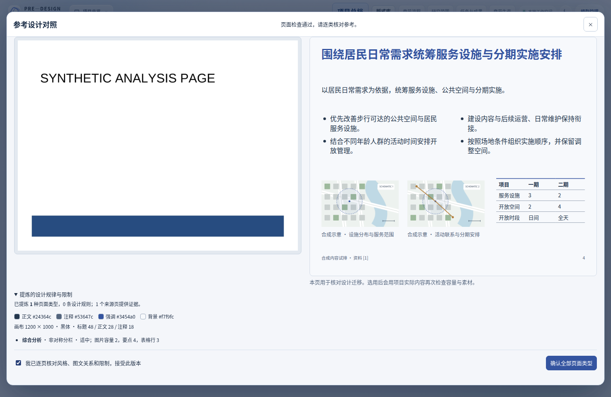

> **历史评审记录：** 本目录评审的是 V14 Reference Design V2 的原始实现及其独立评审分支，记录仍有效但不代表当前架构。后续开发和部署请以 codex/web-v210 及 docs/architecture/REFERENCE_DESIGN_INTEGRATION.md 为准。

# V14 参考设计理解与迁移 V2：Claude 评审入口

## 1. 评审范围与当前状态

本次将 PDF／PPTX／图像参考接入“提取事实 → 分批观察 → 设计 Profile → V2 组合版式 → 原页对照”的流程，重点解决 PPTX 绕过 V14、版式只能落到固定五模板、参考证据与人工确认不完整的问题。

- 分支：`codex/v14-reference-design-v2`。
- 比较基线：`e9d78084776a30a0d674e00e4b69abf9ce3864c2`。
- 已批准设计：[spec](../../superpowers/specs/2026-11-16-v14-reference-design-v2.md)；实现计划：[plan](../../superpowers/plans/2026-11-16-v14-reference-design-v2.md)。
- 执行记录：[WORK_LOG.md](WORK_LOG.md)。此入口的本地阶段结果不能替代最终提交上的 CI。
- **通过完整 CI 的代码提交：`9094cf01da446c437d286590062364ac44460d7f`。** 后续交付提交仅补评审文档及同源验收证据。
- 本分支用于独立评审；没有合并主线或部署生产，没有变更生产端口和数据。

请按风险列出问题、具体位置、触发条件和最小复现；同时区分代码缺陷、环境限制与需要真实模型验收的质量问题。

## 2. 建议阅读顺序

下表文件均相对仓库根目录；除另有标注，模块位于 `web/app/src/layout-library/`。

| 层次 | 入口 | 重点 |
| --- | --- | --- |
| 上传与路由 | `conversation-ui.js`、`reference-document.mjs`、`reference-uploads.mjs`、`reference-limits.mjs` | JSON 原生导入；PPTX 进入参考分析；拥有者、页码、覆盖与解析状态 |
| PPTX 提取 | `reference-pptx.mjs`、`reference-pptx.py`、`vendor/ppt_master/` | ZIP／XML 校验、原生页序与继承、抽样、真实预览、取消清理 |
| 分阶段分析 | `reference-workflow.mjs`、`reference-profile.mjs` | 清单、每批至多 6 张图、证据校验、Profile 与编译一致性 |
| 任务与会话 | `jobs.mjs`、`conversations.mjs`；`web/worker/layout-reference-guard.mjs` | 真实调用收执、失败／取消、修订、意图继承、新附文字 |
| 组合契约与渲染 | `contract.mjs`、`composition-contract.mjs`、`composition-render.mjs`、`render.mjs`、`assets.mjs` | V1 兼容、V2 画布、多图／表格／图表、完整性、安全样式 |
| 人工对照与门禁 | `reference-review.mjs`、`routes.mjs`、`store.mjs`、`review-ui.js`、`validation.mjs` | 源页权限、收执、当前版本、实际检查、发布与应用 |
| 下游接入 | `web/app/src/workflow-contract.mjs`、`web/app/src/workflow-content.mjs`、`web/app/src/workflow-visual-store.mjs` | 结构化内容、项目材料核验、版本冻结、人工覆盖 |
| Skill 与 CI | `web/app/src/skills/layout-reference/SKILL.md`、`skill-bindings.json`、`scripts/layout-library/ci-check.sh` | V08–V14／Q05／Q07 分工与可复现检查 |

## 3. 关键契约与兼容要求

1. **参考与资源分开。** JSON 是原生资源输入；PPTX／PDF／图像走参考工作流。DOCX 没有页面渲染能力时只能声明文字证据。
2. **Profile 可追溯。** `pre-design.reference-profile.v2` 区分 `extracted`、`observed`、`inferred`、`user`；文件、页码、事实 ID 必须能在本轮清单／观察中核对。推断依赖不能循环或悬空。
3. **编译兑现 Profile。** `pre-design.layout-package.v2` 使用 `composition` 与 `archetypeId`；画布、主题、角色、容量、页面原型须匹配。结构迁移还须落实已声明区域；不自动填入五套默认布局。
4. **内容覆盖是硬约束。** 多图、分区正文、表格、图表、时间轴、关系图必须完整承载；遗漏、重复、越界选择器和不适合的手选版式应明确失败。
5. **资源不执行任意代码。** 槽位与样式为受限声明；不接受资源提供的 HTML／CSS／JS、可执行图片或外部脚本。项目图片逐项验证归属与内容。
6. **V1 与人工覆盖继续工作。** 旧资源可读，单图别名与已有覆盖顺序保留；V1 无法容纳的新内容应拒绝。修改已有 V2 时保留、版本化 Profile，不静默降级。
7. **共享内容有边界。** 可复用 Profile 保留设计规则、来源指纹与页码；原文、原图、附件 ID／路径和业务材料留在私有记录。共享资源不授予原件访问权。
8. **确认绑定实际版本。** V2 发布／绑定需通过当前包哈希、渲染器、检查样例及验证收执的核验，并覆盖所有版式的拥有者对照确认。修订或重新检查后须重新确认。
9. **试排性质明确。** `composition-samples.mjs` 使用有内容的合成原型；真实项目通过项目预览／应用路径检查。合成样例通过不等于真实项目适配，也不等于人工认可风格。
10. **失败保持真实。** 坏 JSON、伪造来源、模型故障或取消均不允许生成假成功候选；逐阶段收执保留实际调用结果，不代表外部模型质量已验收。

## 4. 请 Claude 优先检查的边界

- [ ] 后页设计与封面不同：页序、均匀抽样与原始页码是否一致；是否把未渲染页说成已看过。
- [ ] 同一原型同时引用结构页与视觉页：对照是否选择实际存在的预览；无可对照页是否明确阻断。
- [ ] 原生 `sp`／`pic`／`graphicFrame` 到通用角色的映射是否丢失文字、图片、表格、图表。
- [ ] 模型编译保留 Profile 却删掉原型、改画布／主题、遗漏角色或容量时，服务器是否拒绝。
- [ ] 旧 V2 会话新增 TXT、纯文字修订、切换／继承 `style` 与 `structure`，是否遗漏输入或错误重跑视觉分析。
- [ ] 内容在选版之后增加，或者图片与表格同时出现时，渲染前是否仍核验完整覆盖。
- [ ] 通过记录使用旧 renderer／fixturesVersion、资源修订、重检、旧 comparison ID、跨用户收执时，门禁是否失效。
- [ ] 所有发布、项目绑定／应用入口是否执行服务端门禁；预览路径是否无意成为应用旁路。
- [ ] 共享用户、管理员或另一拥有者能否通过指纹／页码获得私有原页；导出是否夹带原文、路径或图片。
- [ ] 大 ZIP、CRC、重复项、实体／DTD、关系继承、宏／嵌入对象、SVG／VML／CSS 外链是否在渲染前受控。
- [ ] 超时／取消能否终止完整子进程组并清理临时文件；缺失 Python／Office／Poppler 时是否如实报错。
- [ ] V1 手工覆盖、资源版本冻结、退役／删除与旧项目重读是否回归；CI 是否包含本分支和实际浏览器检查。

独立预审列出的代码问题已完成修复和针对性回归，复审未留下未解决的 Critical／Important 问题；请仍以最终提交逐项复核，尤其留意跨模块组合与完整 CI 结果。

## 5. 运行依赖与复现

建议在全新、非生产 Linux checkout 中运行；所有命令从仓库根目录执行。

- Node **24.11.0**（CI 固定版本）、npm；包版本由 `scripts/layout-library/ci-install.sh` 固定安装。
- Python **3.10+**；LibreOffice Impress／Writer；Poppler（含 `pdfinfo`、`pdftoppm`、`pdftotext`）；CJK 字体。
- PostgreSQL 服务端工具（`initdb`、`pg_ctl`、`pg_config`）；检查脚本启动一次性数据库，TCP 端口 **55439**。
- 可实际启动的 Chromium／Chrome；可用 `PREPLANNING_BROWSER_EXECUTABLE` 指定路径。
- 可用 `PRE_LAYOUT_PYTHON_BINARY`、`PRE_LAYOUT_OFFICE_BINARY` 指定管理员控制的可执行文件；`PRE_LAYOUT_PG_BIN` 指定 PostgreSQL 工具目录。
- 全套受控工作流测试不要求真实 DSH 凭据；真实模型验收须另外配置目标环境的文本／视觉路由。

取得评审版本并安装依赖：

```bash
git fetch origin codex/v14-reference-design-v2
git switch --detach origin/codex/v14-reference-design-v2
git rev-parse HEAD
git diff --stat e9d78084776a30a0d674e00e4b69abf9ce3864c2...HEAD
bash scripts/layout-library/ci-install.sh
```

`ci-install.sh` 要求隔离 checkout 中没有已有 `node_modules`；不要在现有开发环境直接覆盖依赖。

先复核核心契约与解析：

```bash
node --test --test-concurrency=1 \
  web/app/tests/layout-reference-profile.test.mjs \
  web/app/tests/layout-reference-workflow.test.mjs \
  web/app/tests/layout-library-composition.test.mjs \
  web/app/tests/layout-reference-prototypes.test.mjs
node --test --test-concurrency=1 \
  web/app/tests/layout-reference-pptx.test.mjs \
  web/app/tests/layout-reference-pptx-workflow.test.mjs
```

运行真实 PostgreSQL、回归、构建与浏览器完整检查：

```bash
bash scripts/layout-library/ci-check.sh
```

脚本覆盖 `layout-*.test.mjs`、选定既有 Web 回归、组合渲染、管理／上传／大 PDF／参考对照浏览器测试，并输出 TAP、截图、构建日志与 `receipt.json`。
输出目录为 `${RUNNER_TEMP:-/tmp}/layout-evidence`。仅成功跑完才生成通过收执；失败时应检查之前阶段的日志。
该脚本仅用于隔离 CI，会设置 `PRE_LAYOUT_TEST_NO_SANDBOX=1`；此设置不属于生产运行配置。
单独执行数据库测试且未设置 `PRE_DOSSIER_TEST_DATABASE` 时可能落到 SQLite 测试替身，不能据此宣称 PostgreSQL 通过。

## 6. 验证记录：已观察到与尚未完成

### 最终远端 CI：通过

[完整验证运行](https://github.com/ArchitectureWorld/pre-design/actions/runs/43897176354) 对应上述代码提交，2026-11-16 完成。真实 PostgreSQL、HTTP、LibreOffice／Poppler 与 Chromium 均已执行，零跳过。

| 验证范围 | 结果 |
| --- | --- |
| 版式、参考分析、模型运行时相关测试 | 174／174 通过 |
| 既有 Web／工作流回归 | 54／54 通过 |
| 独立组合浏览器测试 | 2／2 通过：长中文、双图、表格、6:5 画布、图表／关系图与溢出反例 |
| 原生版式工作台 | 24 项界面检查通过 |
| 多格式上传界面 | 16 项界面检查通过 |
| 参考原页与组合试排对照 | 9 项界面检查通过 |
| 100 MiB PDF 流程 | 31 页原件、前 30 页读取、5 批观察、下载哈希不变，通过 |
| Web 构建 | 通过 |

[CI 原始证据包](https://github.com/ArchitectureWorld/pre-design/actions/runs/43897176354/artifacts/14239028776) SHA256：`736c274ee7fd2c97d3f9fb3bd4df01b3183389afc42556b98231ca243f3607bc`。
仓库保留 [receipt.json](evidence/receipt.json)、相关 TAP／界面 JSON 与下图；已逐一核对收执中的 8 个文件哈希，避免仅依赖有保留期限的 CI 产物。



此图来自受控合成夹具，证明原页定位、内容完整呈现、并排预览和确认流程；不代表真实供应商已经学会参考风格。模型调用质量仍按下方独立边界验收。

### 本地阶段记录（2026-11-16）

下列分组来自开发中的各次运行，覆盖范围可能重叠，**不能累计为最终通过总数，也未绑定最终远端 SHA**。

| 分组 | 本地阶段结果 | 解释 |
| --- | --- | --- |
| 原页权限、对照 UI、人工审阅与过期门禁 | 9／9 通过 | 使用一次性 PostgreSQL；包含预览元数据与当前 renderer／fixturesVersion |
| 独立预审修复后的针对性复验 | 37／37 通过 | 本地阶段复验；不是完整 CI，也不代表外部模型质量 |
| 对话上传 UI | 12／12 通过 | DOM 测试；覆盖 PPTX 路由、取消、意图继承等，不等于实际 Chromium |
| 工作流与服务器分组 | 29／30 通过 | 1 项进入实际 Chromium 后受环境限制；该组不能标绿 |
| 组合版式与相关内容回归 | 40／40 通过 | 本地契约／渲染／材料回归；不替代浏览器尺寸测量 |
| PPTX 解析器 | 12／12 通过 | 包含真实 LibreOffice／Poppler 预览、安全拒绝、取消与缺依赖 |
| 最后一次完整本地 layout／模型运行时集合 | 168／174 通过，0 skip | 5 项 Chromium 启动受限；1 项既有 PDF 取消测试读取 `/proc` 子进程失败；没有剩余确定的代码断言失败 |

当前执行环境的 Chromium 因 Unix socket 权限失败；沙箱外执行申请也被自动审批拒绝。因此本地没有完成真实 Chromium 验收，须由远端隔离 CI 补齐并记录结果。

### 真实资料：仅发布匿名统计

| 私有资料样本 | 规模 | 已验证范围 |
| --- | --- | --- |
| 常规样本 A | 10.09 MiB，21 页 | 全页结构提取；21 张真实预览已生成并目视；画布 1280×720；2 母版、14 版式、2 主题 |
| 大文件样本 B | 471.61 MiB，119 页 | 结构／CRC 验证；2,157 个对象；未完成全套页面渲染与模型分析 |
| 大文件样本 C | 491.34 MiB，183 页 | 结构／CRC 验证；2,132 个对象；6 个外部关系被记录；未完成全套页面渲染与模型分析 |
| 大文件样本 D | 421.20 MiB，60 页 | 结构／CRC 验证；716 个对象；未完成全套页面渲染与模型分析 |
| PDF 样本 E | 62.0 MiB，131 页 | 真实解析第 1–30 页，30 张 1600×1132 预览；后 101 页未读；提取原生文字，未进行 OCR |

资料保留了分组变换、复杂原生对象、样式解析等限制提示；部分样本还有隐藏页、外部关系或未解析几何提示。
此处不提供私有文件名、原文、图像、原件或文件指纹。统计证明对应解析路径可执行，不证明 PowerPoint 像素级还原或设计理解正确。

### 仍需目标环境验收

- 外部视觉模型的观察准确率、设计系统总结质量、风格／结构迁移效果与稳定性，**没有实测结论**；当前工作流验证使用受控替身。
- 真实项目长标题、多图／地图、表格／数据混排在目标 DSH 路由上的端到端结果，仍需用户／Claude 检查原页与新样稿。
- 字体替换、复杂装饰、SmartArt／图表语义、旋转分组等不属于高保真复刻承诺；当前输出是原生 HTML，不支持可编辑 PPTX 镜像还原。
- 源代码快照工作流成功本身不等于测试通过；本次通过结论来自上方完整验证运行及其收执。

## 7. 开源复用与边界

采用 [PPT Master 纯模块子集说明](../../../web/app/src/layout-library/vendor/ppt_master/README.md)；来源与逐文件记录见 [UPSTREAM.json](../../../web/app/src/layout-library/vendor/ppt_master/UPSTREAM.json)。
上游固定在 `3af3e8ef774c4d67ee57e1306d9256d08c9ee1bf`，复用 **5 个未经修改的纯 Python 模块**，保留 MIT 许可与版权。
没有包含或调用上游 CLI、Skill 工作流、署名 guard、SVG 渲染器或模板发布器，也没有禁用或替换 guard。
相邻适配器负责安全边界与数据整理；真实预览由 LibreOffice／Poppler 生成，设计推断由本项目的 V14 工作流承担。
详细额度、抽样与精度限制以 vendor README 为准。Profile 综合阶段的输入上限为 140,000 字符，事实密集的大稿可能需要拆分参考后重试；512 MiB 是上传额度，不代表全篇视觉覆盖、任意复杂度分析或已证明生产并发承载能力。
