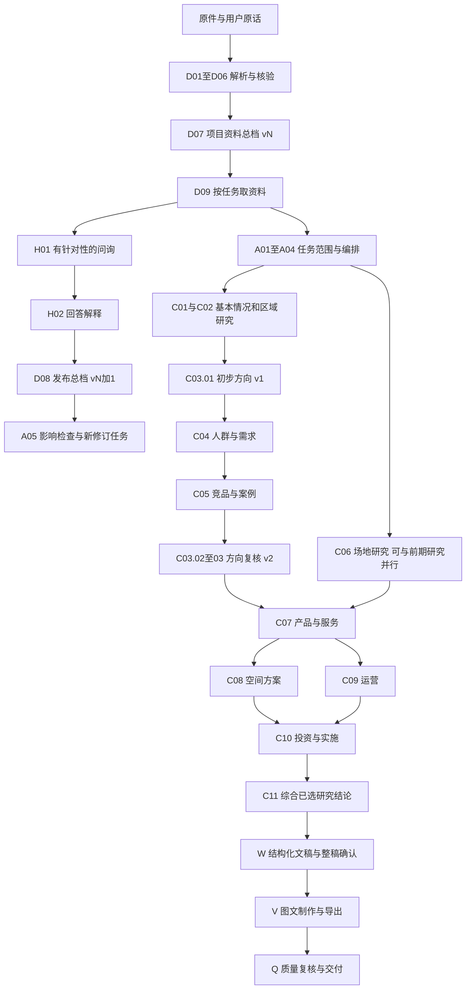

# Pre-design Web Skill 矩阵评审稿

版本：1.0。日期：2026-11-04。适用范围：当前 `pre-design-web-v210` 工作区和新11章体系。

本矩阵覆盖从项目接入、资料和交互整理、任务编排、专业研究，到文稿、视觉成果、审阅和持续修改的完整工作。项目资料总档位于D组，是全流程共同使用的数据基础；它需要与问询、任务范围、来源核验、变更影响和版本控制一起设计。

这里的Skill指平台完成一类业务判断或工作过程的可复用能力。一个Agent可以按任务承担多个Skill；确定性计算、权限、事务和队列交给工程服务。矩阵ID用于讨论和后续登记，尚未写入运行时，不改写旧模块ID或历史成果。

此稿给出建议的能力边界和实施顺序，供逐项评审。现状依据为本次检查的代码与已有验证记录；工作区包含尚未提交的界面和流程改动。“已有基础”表示可复用实现存在，业务采用仍应通过对应样本验收。

## 一 整体组织方式

采用“任务组织＋共用能力＋专业研究＋成果生产＋质量复核＋工程服务”的结构。章节定义专业问题，资料、问询、检索和质量能力跨章复用。每项判断都有明确输入、输出和采用条件，模型负责分析，程序核对结构、引用、权限与数值。

| 组织方式 | 适用处 | 本项目的取舍 |
| --- | --- | --- |
| 每章一个完整大提示词 | 快速生成粗略草稿 | 当前阶段稿已有类似做法；输入、校核和变化影响难以单独修订，适合作为资料归纳模式。 |
| 每个细字段独立Agent | 强隔离的小范围专业校核 | 调用数量和上下文交接成本高，容易失去整体方案；只对确有独立边界的任务采用。 |
| 共用能力加按任务组合的专业Skill | 持续更新、多章联动和多类型项目 | 本矩阵采用此方案；专业结果共享身份和依据，按实际任务组合执行。 |

能力数量是职责划分，不是同一次任务的Agent数或模型调用数。可在同一受控调用中合并兼容步骤；来源核验、计算和最终采用保持明确记录。沿用现有模型与工具接入，矩阵本身不要求增加模型提供方。

## 二 核心规则

1. **同一项目共用资料基础。** 文件、用户原话、要求、偏好、决定、模型分析分别归类。模型产物回流为带来源的派生结果，不能循环证明自身正确。
2. **按用途判断资料是否够用。** 区分资料归纳、条件策划、精确量化和实施核查。仅缺实施审批时，可形成有根据的拟议方案；没有测量或真实边界时，精确指标保持未定。关键未知不能伪装成假设事实。
3. **研究尺度随项目变化。** 直接影响范围、服务客源范围、比较范围各自有依据和版本；同一类型项目也可能不同。新依据可修正早期范围。
4. **研究执行顺序与汇报目录分别管理。** 第03章先给方向假说，04与05章提供研究依据，再形成03章的新版本。反馈生成新的修订任务，同版执行图保持无环。
5. **范围、专业结论和成果采用分别确认。** 用户选章不意味着每项结论成立；暂缓问题会保留限制；整稿确认不自动触发模型生图或所有后续操作。
6. **更新有影响边界。** 新材料和交互发布总档新版本，依赖该信息的任务和成果标记需复核。运行中的任务使用已冻结输入；完成时检查相容性，过期候选保留但不覆盖新基线。
7. **任务完成与内容质量分别判断。** 成功返回JSON、导出文件或HTTP 200只说明对应技术步骤成功。专业合格要看研究回答、证据、计算、条件和用户要求。
8. **所有业务规则对项目通用。** 名称、地点、案例、资源、产品和研究范围来自项目输入。测试样本与运行项目分离。
9. **专业判断和传输协议各有职责。** 模型提交业务候选、证据和推理；程序生成可信ID、时间与版本，组装协议并校验。来源缺失、专业结论不足和格式错误分别诊断，避免把所有问题都转成反复重写整个结果。

## 三 当前架构需要处理的衔接

| 衔接 | 当前依据 | 矩阵中的处理 |
| --- | --- | --- |
| 上传和交互到统一总档 | 文件、outline问答、普通chat和稿件批注分别保存；outline history仅取outline任务。 | D03—D08统一语义归并和增量更新；S02保存版本。 |
| 新11章到旧62项 | 新目录已有；专业任务仍按旧ID映射，原专业结果与新阶段稿属于不同路径。 | A04重新编排；C组定义新职责；旧62项作为可复用实现逐项登记。 |
| 资料条件与策划用途 | Web对06—10章预置相同四项条件；Core允许有依据的条件方案。 | A03按任务和输出精度校准门槛，保留真实事实核验。 |
| 初步方向与案例反馈 | 新草案要求05依赖前四章，反馈主要作为文字说明。 | C03.01与C03.02/03明确前后版本；A05触发反馈修订。 |
| 初稿与专业研究 | Web共用阶段稿提示可生成文本；Core有专业字段、步骤和审查。 | W组消费明确阶段的研究结果，分别验收资料归纳和专业成果。 |
| 条目页与专业视觉链 | 当前工作区已有条目脚本和HTML页；旧Core另有图表、生图、PDF/PPTX。 | V组显式绑定脚本、素材和数据版本，逐格式验收。 |

## 四 依赖与反馈

图展示典型完整项目。不同任务可选用其中一部分；C11汇总实际已选成果，未执行章节保留为范围说明。Q组也在资料、研究、脚本和素材各阶段运行，末端复核不替代过程核验。图中vN加1由新的事件推进，既有快照不回写。

矩阵的“上游能力”描述能力组合与实现依赖，**不表示每个项目必须执行全部列出的章**。实际执行须由A04生成任务图：说明输入对象、版本、是否必需、可用替代和最低可用状态。引用已有效的旧结果可以满足输入；条件输入缺失时由A03决定是否限缩任务。第03章粗算可调用R03/R04比较暂定方案，无需等待08和10整章完成。08、09、10的相互反馈以新版本迭代处理。

竞品案例的候选登记和专业筛选也分开：R05依据A02暂定范围登记候选、维护共同对象和证据；C05.01确定竞争范围与竞品纳入排除，C05.03确定案例适用性；选择结果再通过D08更新共享索引。R05可在没有筛选结论时工作，不等待C05先给出最终对象集。

## 五 项目资料总档在矩阵中的位置

本轮总档需求直接覆盖D01—D09，并依赖H01/H02/H04的问询与决定、A05的影响检查和S01/S02/S04/S05的可靠保存与执行。

建议将JSON结构作为主数据，存入现有数据库的版本化记录；JSON文件和Markdown阅读稿由同一快照导出。原件、完整原话和解析片段独立保留，总档通过稳定ID及页行或图中定位引用。用户更正通过受控编辑回到主数据，避免出现两份内容各自更新。

每条信息至少区分：对象与属性、原值与标准值、单位、时点和范围、信息性质、原文来源、核验状态、采用状态、替代关系。用户要求和模型推断不能因“已同步”变成已核事实。来源发布日期、上传时间和实际有效时间分别记录。

自动同步按“事件登记→增量提取→冲突检查→版本提交→影响检查”进行。原始事件立即入库，内容归并可异步完成；页面区分待处理、处理中、已同步、部分完成和失败。失败不删除原输入或损坏当前主档。新资料与更正优先追踪受影响条目，资料撤回会撤销其当前支持关系并保留权限允许的审计记录。

更新入口同时覆盖研究与审查。外部检索取得的原文快照走D01—D06来源整理；R和C组生成的结论、方案和计算结果保存为不可变研究成果，并由D08更新总档的派生成果索引。Q组改变质量状态、用户采用或撤回成果时，D08更新对应状态，A05通知下游复核。派生成果引用其来源和输入版本，不复制成新的“独立事实”。纯版式修改更新页面版本和相关成果引用，事实条目保持原内容。

因此，总档有“来源与项目条目”和“派生成果索引”两个明确区域。D09取用时必须保留区域、来源、质量和采用状态；未经审查的研究只能作为候选信息，不能充当下游已通过的专业输入。

| 资料类型 | 当前实现边界 | 总档阶段的处理 |
| --- | --- | --- |
| 有文字层PDF及文本类文件 | 有读取与页行定位基础 | 先支持稳定提取、覆盖记录和来源校验。 |
| 扫描PDF | 可识别需OCR；未形成完整OCR接入 | 登记待处理，后续接OCR并记录识别质量和区域定位。 |
| 表格及Office文档 | CSV等文本可读；复杂Office非完整解析流水线 | 保留原件，分期接结构化解析，保持表头、单位和合并关系。 |
| 图片 | 已有上传及元数据读取；不等于内容理解 | 接入实际视觉识别收执，单独标注识别和推断，不能用元数据冒充内容。 |
| CAD与其他专业文件 | 当前新CAD上传要求转PDF或图片；历史原件可下载 | 明确转换状态；原生几何或BIM解析另立工具适配验收。 |
| 压缩包及目录 | 目录上传已有基础；压缩包不能视为已逐件解析 | 登记包内覆盖及失败项，专用安全展开能力未验收前不宣称已读。 |
| 用户交互与批注 | 多入口分别持久化 | 按事件ID归档并提取有效项目内容；已存原话不丢失，答案关联对应问题和对象。 |

P0优先完成统一接口、状态与已有可读格式的真实闭环；OCR、复杂Office和专业几何适配可以分批扩展。原件已登记、文本已提取、信息已归并、结论已核实是四个不同状态。

## 六 能力组总览

| 组 | 能力范围 | 项数 | 作用 |
| --- | --- | ---: | --- |
| A | 任务组织与范围判断 | 5 | 把用户目标转换为可执行、可调整的研究任务。 |
| D | 资料与项目总档 | 9 | 把文件和交互转为有来源、可更新、可复用的信息。 |
| H | 用户交互与决定 | 4 | 围绕实质问题问询，准确理解回答、修改和确认。 |
| R | 通用研究方法 | 6 | 提供跨章复用的检索、空间分析、计算和证据综合。 |
| C | 十一章专业研究 | 39 | 形成各章实际研究结论、拟议方案与适用条件。 |
| W | 文稿与审阅 | 5 | 把研究组织为章、节、条及独立备注，形成可审阅稿件。 |
| V | 图表与成果制作 | 6 | 按内容选择地图、分析图、图片和版式，形成可交付成果。 |
| Q | 质量与交付复核 | 6 | 核查来源、数量、跨章逻辑、文字和视觉质量。 |
| S | 工程支撑与维护 | 8 | 由程序保证权限、版本、预算、执行、资产与运行可靠性。 |

合计 **88项能力**，其中专业研究39项，工程支撑8项。角色、工具和用户决定在明细中分别标注。

| 现状标记 | 含义 |
| --- | --- |
| 已有基础 | 对应实现可复用，新增接口和业务质量仍需验证。 |
| 部分覆盖 | 有一些必要步骤，但当前目标链条尚不完整。 |
| 待建立 | 尚无统一实现，需要建立明确契约与执行路径。 |
| 待重组 | 旧专业能力存在，需按新章职责和依赖重新组织。 |
| 需校准 | 现有规则间存在需要对齐的边界。 |

## 七 新十一章职责与能力分配

| 章 | 章节 | 职责边界 | 拟议能力ID |
| --- | --- | --- | --- |
| 01 | 项目基本情况 | 表达项目是谁、本轮解决什么问题；任务授权由A01和H04统一管理。 | C01.01、C01.02、C01.03 |
| 02 | 城市与周边 | 解释区域关系、客源联系和可达性；竞争对象筛选归05章。 | C02.01、C02.02、C02.03 |
| 03 | 项目发展方向 | 先提出可检验的方向，再结合04和05章复核、比较、定向。 | C03.01、C03.02、C03.03 |
| 04 | 人群与需求 | 研究服务谁、为何使用、需求强度及优先级；不提前替产品方案作结论。 | C04.01、C04.02、C04.03 |
| 05 | 竞品与案例分析 | 综合前四章研究竞争关系与可借鉴机制，再反馈方向和产品。 | C05.01、C05.02、C05.03、C05.04 |
| 06 | 场地现状 | 识别真实场地资源、使用和限制；方案选择归07与08章。 | C06.01、C06.02、C06.03、C06.04 |
| 07 | 功能与项目内容 | 把目标人群和资源转为产品服务；产业研究按项目实际触发。 | C07.01、C07.02、C07.03、C07.04 |
| 08 | 空间布局与建设方案 | 把产品转为空间组织、容量与建设安排，区分概念关系和精确落位。 | C08.01、C08.02、C08.03、C08.04、C08.05 |
| 09 | 开发与运营 | 明确谁组织、怎样提供服务、如何持续运行；承诺与设想分开。 | C09.01、C09.02、C09.03、C09.04 |
| 10 | 投资与实施 | 形成可复算投资及运行情景、实施安排和调整机制。 | C10.01、C10.02、C10.03、C10.04 |
| 11 | 结论与建议 | 综合已选章节的有效成果和限制，给出决定事项；不补造未研究结论。 | C11.01、C11.02 |

## 八 详细能力矩阵

每项的触发、输入输出和验收是后续Skill设计的最低要求；P0/P1/P2为建议优先级。引用E编号对应文末代码依据。

### A 任务组织与范围判断

把用户目标转换为可执行、可调整的研究任务。

| ID与名称 | 方式及优先级 | 输入与输出 | 上游能力 | 关键验收 | 现状及差距 |
| --- | --- | --- | --- | --- | --- |
| A01 任务意图与交付边界 | 判断Skill；P0 | 输入：项目总档；原始委托；用户任务陈述；输出：任务简报；目标与交付清单；范围版本 | D09 | 同一资料用于概念策划和实施核查时，输出不同任务边界；愿望不变成事实。 | 部分覆盖。已有任务简报与角色提示；各入口尚未统一消费同一任务版本。 依据：E03、E05、E06 |
| A02 项目类型与研究尺度 | 判断Skill；P0 | 输入：项目类型；服务对象；影响力证据；任务简报；输出：三个研究范围；对象选择规则；待核边界 | A01、D09 | 社区更新与区域景区采用不同范围；不能从占地面积或项目名称直接推出统一半径。 | 部分覆盖。新草案有三个文本尺度；尚未统一传递到检索、OD和竞品筛选的可检验参数。 依据：E03、E08 |
| A03 任务适用性与资料充分性 | 判断Skill；P0 | 输入：任务用途；总档的已知、缺口和冲突；所需证据；输出：任务能力表；条件限制；必要补充项 | A01、D09 | 仅缺实施审批时允许有依据的条件策划；缺关键测量时不输出精确面积或确定性容量。 | 需校准。Web对06—10章统一要求四项条件；Core允许条件方案，两层需要按任务用途校准。 依据：E05 |
| A04 章节与任务编排 | 组合流程；P0 | 输入：用户选章；任务能力；可复用成果；资源预算；输出：可执行任务图；阶段输入快照；明确跳过项 | A02、A03、H04 | 03初步方向→04需求→05竞品案例→03方向复核能执行，且不会把反馈边强塞进同版DAG。 | 待重组。已有选章、拖放和旧模块依赖；新章任务图与阶段语义未统一。 依据：E03、E05、E18 |
| A05 变更影响与复核安排 | 组合流程；P0 | 输入：总档增量；研究或成果版本事件；采用撤回；条目引用关系；输出：受影响任务清单；复用或复核建议 | D08、S02 | 改变客群、红线或撤销研究采用，均能追踪下游；无关章节保持原结果，历史稿可回读。 | 待建立。现有部分过期检查和研究复用检查；尚无跨总档、研究、脚本、页面的统一影响图。 依据：E03、E04、E15 |

### D 资料与项目总档

把文件和交互转为有来源、可更新、可复用的信息。

| ID与名称 | 方式及优先级 | 输入与输出 | 上游能力 | 关键验收 | 现状及差距 |
| --- | --- | --- | --- | --- | --- |
| D01 资料盘点与解析分流 | 组合流程；P0 | 输入：上传原件；检索归档的外部快照；文件登记；已有解析结果；输出：资料目录；重复关联；解析计划与覆盖状态 | S01、S06 | 文件夹层级保留；重复上传不重复计为独立证据；未解析文件不被算作已知内容。 | 部分覆盖。原件登记、哈希和格式判断存在；语义分类、版本识别及统一解析队列待补。 依据：E01、E07 |
| D02 文档表格与影像内容提取 | 组合流程；P0 | 输入：D01解析计划；原件及页行或影像区域；输出：结构化片段；位置；单位；读取覆盖；解析限制 | D01、S03 | 扫描PDF需OCR时明确待处理；图片元数据不算图中信息；表格合并单元和单位不能丢失。 | 部分覆盖。已有PDF文本、文本类文件和影像元数据；Office、OCR、CAD及影像语义读取尚非完整流水线。 依据：E01、E02 |
| D03 用户交互结构化 | 判断Skill；P0 | 输入：用户原话；对应提问；入口；时间；目标对象；输出：可追溯的交互条目；原话引用；意图类别 | S01、S02 | 普通对话、章节问答和稿件批注都能归档；模型建议不会因出现在对话中成为用户决定。 | 待建立。问答和批注分散保存；章节history只读取outline任务，缺跨入口语义归并。 依据：E03、E04 |
| D04 实体识别与口径标准化 | 判断Skill；P0 | 输入：提取片段；交互条目；原有实体与别名；输出：稳定实体ID；原值与标准值；单位、时点和范围 | D02、D03 | 同名异地对象不合并；研究范围面积和实施红线面积不合并；单位转换可复算。 | 待建立。竞品和专业字段已有局部对象身份；全项目跨来源实体与指标口径未统一。 依据：E06、E10 |
| D05 来源绑定与信息性质判断 | 判断Skill；P0 | 输入：标准化条目；文件读取收执；对话来源；输出：带来源的主张；性质；适用范围；核验状态 | D04 | 任一事实可返回原文页行或用户原话；来源存在不等于事实已独立核实；拟议方案不冒充现状。 | 部分覆盖。Core有claim和引文验证；用户要求、对话与Web阶段稿缺统一主张协议。 依据：E02、E06 |
| D06 冲突时效与更正判断 | 判断Skill；P0 | 输入：同实体同指标的候选值；原件日期；生效日期；用户更正；输出：冲突组；采用建议；待确认问题；替代关联 | D05 | 较晚上传的旧文件不压过新有效文件；口径不同可并存；重要未决冲突不被静默覆盖。 | 待建立。专业研究有局部冲突字段；尚无总档层面的跨文件、跨问答处理。 依据：E06、E10 |
| D07 项目资料总档归并 | 组合流程；P0 | 输入：资料目录；实体和主张；冲突；用户决定；研究结果及采用状态引用；输出：版本化JSON总档；同版Markdown；派生成果索引；变更说明 | D06、S02 | 信息均有稳定ID、性质、出处及范围；派生结论不覆盖来源事实；JSON和MD同版一致。 | 待建立。目前有文件清单、草案和专业对象，没有统一项目资料总档。 依据：E01、E03、E04、E06 |
| D08 总档增量同步 | 组合流程；P0 | 输入：新增或撤回资料；用户交互；研究版本；审查与采用状态；旧总档版本；输出：新总档版本；差异；派生状态；待处理事件；影响检查输入 | D07、S04、S05 | 重复事件幂等；解析失败保护当前档；采用撤回触发下游复核；模型结论不升级为外部证据。 | 待建立。上传与对话有事件；缺跨研究、QA和总档的统一增量处理及回流。 依据：E01、E03、E06、E15 |
| D09 按任务取用项目资料 | 组合流程；P0 | 输入：任务范围；总档版本；来源读取能力；输出：任务资料包；选取与遗漏说明；回查入口 | D07 | 长资料不因截断而被说成已全部读取；相关冲突与限制随所引条目一起交付。 | 部分覆盖。Core有语料切片和来源引用；尚未接统一总档及跨问答信息。 依据：E02、E06 |

### H 用户交互与决定

围绕实质问题问询，准确理解回答、修改和确认。

| ID与名称 | 方式及优先级 | 输入与输出 | 上游能力 | 关键验收 | 现状及差距 |
| --- | --- | --- | --- | --- | --- |
| H01 问题发现与问询排序 | 判断Skill；P0 | 输入：任务资料包；能力判定；已有回答；输出：少量具体问题；为什么问；影响任务；可暂缓范围 | D09、A03 | 资料已有答案不重复问；不让用户代做模型应完成的分析；实施审批问题不阻塞无关研究。 | 部分覆盖。已有最多6问、阻断标记和跳过；缺跨入口去重和任务级影响排序。 依据：E03、E05 |
| H02 回答解释与待办闭合 | 判断Skill；P0 | 输入：用户原话；对应问题；已有冲突和决定；输出：更新候选；问题状态；未解决部分 | D03、D06 | 用户说暂未知仅关闭本轮追问，不把缺失值改为已具备；一答多问可逐项关联。 | 部分覆盖。保留问答与跳过收执；缺稳定问题语义和跨版本回答关联。 依据：E03 |
| H03 修改意见定位 | 判断Skill；P1 | 输入：反馈原文；选定章节条页；当前成果版本；输出：明确的修改请求；受影响对象；歧义问题 | D03、S02 | 只改某页排版不改项目事实；跨页意见可明确范围；过期目标不会覆盖新稿。 | 部分覆盖。已有block/item和页面修改；跨总档与研究层的修改分流待建立。 依据：E04 |
| H04 用户决定与确认记录 | 用户决策流程；P0 | 输入：待决定对象；内容及版本；用户明确操作；输出：带对象、版本和范围的确认或暂缓收执 | A03、D07、S02 | 确认目录不等于批准结论；跳过问题不补齐事实；模型文字不生成用户授权。 | 部分覆盖。已有流程确认、跳过及整稿确认基础；决策类型尚未贯穿所有能力。 依据：E03、E04 |

### R 通用研究方法

提供跨章复用的检索、空间分析、计算和证据综合。

| ID与名称 | 方式及优先级 | 输入与输出 | 上游能力 | 关键验收 | 现状及差距 |
| --- | --- | --- | --- | --- | --- |
| R01 研究问题与检索组织 | 判断Skill；P1 | 输入：任务目标；尺度；资料包；来源缺口；输出：检索问题与查询；来源优先级；停止条件 | A01、A02、D09、S03 | 有可用证据时避免重复查询；零结果明确保留缺口；不无限改词重试。 | 部分覆盖。Exa等适配与原生web子会话已有基础；跨章查询和总档复用待衔接。 依据：E07 |
| R02 外部证据适用性核验 | 判断Skill；P1 | 输入：网页或文档原文快照；来源信息；所支持的主张；输出：可采用证据；排除理由；未核事项 | D05、S03 | 搜索摘要不直接当结论；同名对象和过期文件排除；来源说法与独立核实分开。 | 部分覆盖。已有来源归档、引文和领域校验；来源适用判断仍需逐项任务验收。 依据：E02、E07 |
| R03 空间定位与可达性分析 | 组合流程；P1 | 输入：明确对象与入口；几何及CRS；交通方式；时点；输出：定位与空间计算结果；底图依据；误差限制 | D09、S03 | 无真实入口不以行政中心代替；直线距离不冒充路网时间；图形坐标与单位正确。 | 部分覆盖。已有边界、OD和地图模块；外部路网与底图服务的项目条件需单独接入验证。 依据：E08 |
| R04 指标情景与计算 | 组合流程；P1 | 输入：参数及来源；单位；公式；情景边界；输出：可复算结果；参数表；区间；适用限制 | D05、S03 | 原始数值、假设和计算值区分；零与未知不同；分母、币种、时间、含税口径一致。 | 部分覆盖。Core有字段、计算和报告数量校核；跨新11章统一参数与情景版本待接。 依据：E09 |
| R05 竞品案例共同对象库 | 组合流程；P1 | 输入：候选对象和来源；A02暂定范围；已有05章选择结果（如有）；输出：共享候选记录；可比字段；带出处的分类结果索引 | A02、D04、R02 | 候选对象可在筛选前登记；范围和纳入排除由C05决定；同一对象可兼竞品和案例。 | 部分覆盖。已有peerId及可比价格、经营证据规则；新05章对象库与总档尚未统一。 依据：E10 |
| R06 证据综合与方案推理 | 判断Skill；P1 | 输入：可引用证据；上游成果；计算结果；相反证据；输出：结论与理由；选项；条件；未解决事项 | D09 | 结论能说明证据和推导；不能只列资料清单；模型生成结论不成为独立外部证据。 | 部分覆盖。Core有synthesis、独审和条件方案指令；新章结果与阶段稿尚缺统一调用。 依据：E05、E06 |

### C 十一章专业研究

形成各章实际研究结论、拟议方案与适用条件。

| ID与名称 | 方式及优先级 | 输入与输出 | 上游能力 | 关键验收 | 现状及差距 |
| --- | --- | --- | --- | --- | --- |
| C01.01 项目身份与来历 | 判断Skill；P1 | 输入：总档身份条目；任务简报；原文依据；输出：项目概况卡；身份冲突；采用依据 | A01、D09 | 同名异地项目不能混入；文件目录名不直接作为正式名称。 | 待重组。旧专业规格和执行器可复用；需按新章节职责整理输入输出、阶段依赖及真实业务验收。 依据：E06 |
| C01.02 项目阶段与已知条件概况 | 判断Skill；P1 | 输入：总档；资料充分性结果；输出：条件概况；本轮可研究范围；关键缺口 | C01.01、A03 | 只汇总真实已知和明确限制，不把未审批统一表述为不能策划。 | 待重组。旧专业规格和执行器可复用；需按新章节职责整理输入输出、阶段依赖及真实业务验收。 依据：E03、E05 |
| C01.03 策划问题与成果边界表达 | 判断Skill；P1 | 输入：A01任务简报；项目身份；用户决定；输出：问题—分析—成果对应表；本章说明 | A01、C01.01、H04 | 陈述与任务版本一致；本章不另行扩大研究范围或替用户新增目标。 | 待重组。旧专业规格和执行器可复用；需按新章节职责整理输入输出、阶段依赖及真实业务验收。 依据：E06 |
| C02.01 区域结构与联系对象 | 判断Skill；P1 | 输入：项目身份；尺度规则；区位资料；输出：区域结构；重点联系对象；选择理由 | C01.01、A02、R03 | 关系有实际需求或资源依据；不因行政等级机械列周边城市。 | 待重组。旧专业规格和执行器可复用；需按新章节职责整理输入输出、阶段依赖及真实业务验收。 依据：E06、E08 |
| C02.02 到达路径与服务范围 | 判断Skill；P1 | 输入：区域对象；入口与交通资料；尺度规则；输出：到达比较；服务圈；接驳限制 | C02.01、A02、R03 | 直线、道路里程和通行时间分别表达；位置不明时限制精确计算。 | 待重组。旧专业规格和执行器可复用；需按新章节职责整理输入输出、阶段依赖及真实业务验收。 依据：E06、E08 |
| C02.03 区域阻隔与联动机会 | 判断Skill；P1 | 输入：区域结构；可达性；真实对象和用途；输出：阻隔机制；联动方案；改善前提 | C02.01、C02.02、R06 | 潜在联动不写成已有合作；明确对象、作用和成立条件。 | 待重组。旧专业规格和执行器可复用；需按新章节职责整理输入输出、阶段依赖及真实业务验收。 依据：E06 |
| C03.01 初步发展方向与待检验假说 | 判断Skill；P1 | 输入：项目任务；区域关系；已知资源；用户要求；输出：方向候选v1；各方向的依据、未知和反证问题 | C01.03、C02.01、D09、R06 | 初步定位标明暂定依据；不把尚未完成的竞品研究写成已经支持方向。 | 待重组。旧专业规格和执行器可复用；需按新章节职责整理输入输出、阶段依赖及真实业务验收。 依据：E05、E06 |
| C03.02 发展路径比较与方向复核 | 判断Skill；P1 | 输入：方向v1；04章需求；05章结论；共同情景参数；输出：路径比较；保留与排除理由；方向修订v2 | C03.01、C04.03、C05.04、R04、R06 | 路径在内容或运营空间逻辑上确有差异；比较有共同口径，不能只做口号评分。 | 待重组。旧专业规格和执行器可复用；需按新章节职责整理输入输出、阶段依赖及真实业务验收。 依据：E05、E06、E09 |
| C03.03 定位策略与阶段目标 | 判断Skill；P1 | 输入：路径复核；用户目标；明确不做事项；输出：定位与策略；阶段目标；选择条件 | C03.02、R06 | 每项策略能解释服务对象及价值；用户未选择的推荐保持建议状态。 | 待重组。旧专业规格和执行器可复用；需按新章节职责整理输入输出、阶段依赖及真实业务验收。 依据：E06 |
| C04.01 人口经济与需求基础 | 判断Skill；P1 | 输入：任务范围；时点一致的人口经济资料；输出：人群与背景基线；数据适用范围 | C01.01、A02、R02、R04 | 统计地域和年份明确；宏观人口不直接当作项目客流。 | 待重组。旧专业规格和执行器可复用；需按新章节职责整理输入输出、阶段依赖及真实业务验收。 依据：E06 |
| C04.02 需求行为与需求量情景 | 判断Skill；P1 | 输入：背景基线；可达性；调查或使用证据；输出：需求场景；条件需求量；未满足需求线索 | C04.01、C02.02、R04 | 样本范围和外推限制可见；需求量能还原参数和公式，假设不冒充调查。 | 待重组。旧专业规格和执行器可复用；需按新章节职责整理输入输出、阶段依赖及真实业务验收。 依据：E06、E09 |
| C04.03 核心客群与需求优先级 | 判断Skill；P1 | 输入：需求分析；初步方向；用户目标；输出：核心与次级人群；需求排序；暂不服务范围 | C04.02、C03.01、R06 | 目标客群是有理由的研究选择；不得把选择写成已到访客群。 | 待重组。旧专业规格和执行器可复用；需按新章节职责整理输入输出、阶段依赖及真实业务验收。 依据：E05、E06 |
| C05.01 竞争范围与竞品筛选 | 判断Skill；P1 | 输入：项目边界与任务；三个尺度；初步方向；目标需求；输出：竞争范围；对象集合；排除理由；空间分布需求 | C01.03、C02.02、C03.01、C04.03、R05 | 竞争由相同或可替代需求及实际竞争范围决定；附近项目不自动是竞品。 | 待重组。旧专业规格和执行器可复用；需按新章节职责整理输入输出、阶段依赖及真实业务验收。 依据：E03、E08、E10 |
| C05.02 竞品产品与运营比较 | 判断Skill；P1 | 输入：竞品对象库；产品、价格和经营来源；输出：可比维度表；竞争优势；证据缺口 | C05.01、R04、R05 | 票价、免费条件、时点和产品口径一致；宣称客群与观察客群分开，热度不代替盈利。 | 待重组。旧专业规格和执行器可复用；需按新章节职责整理输入输出、阶段依赖及真实业务验收。 依据：E09、E10 |
| C05.03 案例筛选与机制研究 | 判断Skill；P1 | 输入：前四章问题与范围；候选案例；共同特征依据；输出：案例清单；机制拆解；相似与差异条件 | C01.03、C02.01、C03.01、C04.03、R05 | 共同点与本项目问题有实质关系；案例可跨地区，也可与竞品重合。 | 待重组。旧专业规格和执行器可复用；需按新章节职责整理输入输出、阶段依赖及真实业务验收。 依据：E03、E10 |
| C05.04 竞争结论与借鉴转译 | 判断Skill；P1 | 输入：竞品比较；案例机制；效果与反例；输出：竞争机会；可用与不适用做法；方向复核输入 | C05.02、C05.03、R06 | 每项借鉴说明适用对象和转化条件；结论有去向，能反馈03并支持07。 | 待重组。旧专业规格和执行器可复用；需按新章节职责整理输入输出、阶段依赖及真实业务验收。 依据：E06、E10 |
| C06.01 范围权属与规划条件 | 判断Skill；P2 | 输入：原件及有效版本；边界几何；权属与规划依据；输出：范围和权利条件；控制要求；待核项 | D09、R02、R03 | 历史管理范围不代替本项目红线；研究边界与法定实施边界可分开使用。 | 待重组。旧专业规格和执行器可复用；需按新章节职责整理输入输出、阶段依赖及真实业务验收。 依据：E05、E06、E08 |
| C06.02 自然文化与可用资源 | 判断Skill；P2 | 输入：自然环境、文化历史等原始资料；实地记录；输出：资源对象表；价值判断；拟议转化与限制 | D09、R02、R06 | 既有资源与拟议活动分开；有具体对象和机制，不只罗列资源标签。 | 待重组。旧专业规格和执行器可复用；需按新章节职责整理输入输出、阶段依赖及真实业务验收。 依据：E05、E06 |
| C06.03 现状空间建筑与使用 | 判断Skill；P2 | 输入：位置和范围；可读取图纸影像；现场资料；输出：现状使用结构；可用载体；待检测事项 | C06.01、D09、R03 | 照片不能直接证明结构安全或权属；现状用途、登记用途及拟用途分开。 | 待重组。旧专业规格和执行器可复用；需按新章节职责整理输入输出、阶段依赖及真实业务验收。 依据：E01、E06 |
| C06.04 设施安全与承载条件 | 判断Skill；P2 | 输入：空间与设施资料；检测或调查；需求情景；输出：设施条件；约束机制；需专项核实事项 | C06.03、R03、R04 | 缺检测时不能保证安全；能够支持的策划判断和不能下的结论分别表达。 | 待重组。旧专业规格和执行器可复用；需按新章节职责整理输入输出、阶段依赖及真实业务验收。 依据：E05、E06 |
| C07.01 产业适配与导入分支 | 判断Skill；P2 | 输入：定位；需求；真实产业资源；竞争和案例依据；输出：产业方向；进入退出边界；项目库；配套需求 | C03.03、C04.03、C06.02、C05.04 | 无产业任务时跳过；不为完整章节强行增加产业；拟合作不写成已签约。 | 待重组。旧专业规格和执行器可复用；需按新章节职责整理输入输出、阶段依赖及真实业务验收。 依据：E06 |
| C07.02 产品与功能服务组合 | 判断Skill；P2 | 输入：定位；客群；借鉴机制；资源条件；输出：产品服务清单；需求与资源对应；组合取舍 | C03.03、C04.03、C05.04、C06.02 | 每项产品说明服务谁、依托什么、创造什么价值；无需等待已有产品实物才提出方案。 | 待重组。旧专业规格和执行器可复用；需按新章节职责整理输入输出、阶段依赖及真实业务验收。 依据：E05、E06 |
| C07.03 体验场景与时间组织 | 判断Skill；P2 | 输入：产品清单；行为需求；运行限制；输出：体验序列；活动安排；时间互补关系 | C07.02、C04.02、R06 | 活动和场景能对应真实资源与服务对象，避免只有主题名称。 | 待重组。旧专业规格和执行器可复用；需按新章节职责整理输入输出、阶段依赖及真实业务验收。 依据：E06 |
| C07.04 服务容量与配置强度 | 判断Skill；P2 | 输入：需求情景；体验过程；周转与承载参数；输出：容量区间；配置建议；扩展与缩减触发条件 | C07.03、R04 | 人数、时长、周转、面积口径闭合；条件参数有理由和敏感性。 | 待重组。旧专业规格和执行器可复用；需按新章节职责整理输入输出、阶段依赖及真实业务验收。 依据：E06、E09 |
| C08.01 总体空间与功能关系 | 判断Skill；P2 | 输入：产品；资源；边界与现状空间；可用底图；输出：空间结构；功能对应；概念或精确表达等级 | C07.02、C06.01、C06.03、R03 | 概念关系图可有依据地产出；缺准确边界时不冒充精确总平或指标校核。 | 待重组。旧专业规格和执行器可复用；需按新章节职责整理输入输出、阶段依赖及真实业务验收。 依据：E05、E06、E08 |
| C08.02 面积强度与建筑利用 | 判断Skill；P2 | 输入：空间结构；容量需求；范围；建筑证据；输出：面积与强度表；拆改留候选；待检测条件 | C08.01、C07.04、C06.01、R04 | 面积可复算且边界一致；未经检测不认定结构可用；拟议动作有条件说明。 | 待重组。旧专业规格和执行器可复用；需按新章节职责整理输入输出、阶段依赖及真实业务验收。 依据：E06、E09 |
| C08.03 到达流线与后勤组织 | 判断Skill；P2 | 输入：区域到达；功能布局；体验过程与服务量；输出：流线方案；接驳和后勤组织；冲突处理 | C08.01、C02.02、C07.03、R03 | 游客、日常使用、服务后勤及必要应急关系可解释，入口引用保持一致。 | 待重组。旧专业规格和执行器可复用；需按新章节职责整理输入输出、阶段依赖及真实业务验收。 依据：E06 |
| C08.04 景观生态与典型节点 | 判断Skill；P2 | 输入：空间结构；资源；可借鉴机制；输出：公共空间系统；节点要求；风貌与生态策略 | C08.01、C06.02、C05.04 | 图文对应真实空间目的，案例做法经条件转换，不直接复制案例场景。 | 待重组。旧专业规格和执行器可复用；需按新章节职责整理输入输出、阶段依赖及真实业务验收。 依据：E06 |
| C08.05 专项支撑与分期空间 | 判断Skill；P2 | 输入：空间与指标；现状设施；流线；输出：专项需求；分期空间；过渡方案；接口条件 | C08.02、C08.03、C06.04 | 首期能说明独立运行条件；不把专项待确认自动写成已满足。 | 待重组。旧专业规格和执行器可复用；需按新章节职责整理输入输出、阶段依赖及真实业务验收。 依据：E06 |
| C09.01 开发运营模式与责任 | 判断Skill；P2 | 输入：定位；产品；用户目标；参与方证据；输出：模式选项；责任分工；价值与权利关系 | C07.02、C03.03、R06 | 拟议角色与已参与主体分开；公共服务和经营职责有明确承担者。 | 待重组。旧专业规格和执行器可复用；需按新章节职责整理输入输出、阶段依赖及真实业务验收。 依据：E06 |
| C09.02 服务组织与日常运行 | 判断Skill；P2 | 输入：产品和体验；容量；组织模式；服务要求；输出：运行方案；服务标准；人员班次；筹备与维护安排 | C09.01、C07.03、C07.04 | 运营资源匹配服务频次和承载；免费服务也说明成本与责任来源。 | 待重组。旧专业规格和执行器可复用；需按新章节职责整理输入输出、阶段依赖及真实业务验收。 依据：E05、E06 |
| C09.03 合作招商与获客组织 | 判断Skill；P2 | 输入：责任模式；人群；产品；主体能力证据；输出：合作或自供方案；渠道；准备事项 | C09.01、C04.03、R02 | 没有外部伙伴或营销任务时可采用自供、服务告知等路线；不得强行招商营销。 | 待重组。旧专业规格和执行器可复用；需按新章节职责整理输入输出、阶段依赖及真实业务验收。 依据：E06 |
| C09.04 持续运行与收支机制 | 判断Skill；P2 | 输入：运行组织；价格或预算参数；资金责任；输出：经营或公共服务逻辑；收支情景；平衡条件 | C09.02、R04 | 利用率、收入和成本分别有口径；没有经营收入不等于没有公共价值。 | 待重组。旧专业规格和执行器可复用；需按新章节职责整理输入输出、阶段依赖及真实业务验收。 依据：E06、E09 |
| C10.01 实施包与投资构成 | 判断Skill；P2 | 输入：容量；建筑和专项方案；同口径单价或预算假设；输出：实施包；数量成本表；投资区间与排除项 | C07.04、C08.02、C08.05、R04 | 数量、单价、税费、时点和费用边界可复算；假设预算不伪称市场报价。 | 待重组。旧专业规格和执行器可复用；需按新章节职责整理输入输出、阶段依赖及真实业务验收。 依据：E05、E06、E09 |
| C10.02 资金与现金流情景 | 判断Skill；P2 | 输入：投资包；运营收支；资金证据及假设；输出：资金方案；现金流；缺口；平衡和压力情景 | C10.01、C09.04、R04 | 申请、批准、到账、可用分开；不同情景共用可追溯的参数版本。 | 待重组。旧专业规格和执行器可复用；需按新章节职责整理输入输出、阶段依赖及真实业务验收。 依据：E06、E09 |
| C10.03 实施路径与首期安排 | 判断Skill；P2 | 输入：实施包；空间分期；真实权利和前提；输出：实施顺序；首期任务；依赖；待确认事项 | C10.01、C08.05、C06.01 | 预计时长写清依据；建设许可未知保留为实施条件，不能伪称已经批准。 | 待重组。旧专业规格和执行器可复用；需按新章节职责整理输入输出、阶段依赖及真实业务验收。 依据：E06 |
| C10.04 风险敏感性与后评估 | 判断Skill；P2 | 输入：投资运行情景；实施依赖；目标与不确定性；输出：压力情景；调整阈值；监测口径和责任 | C10.02、C10.03、R04 | 风险有作用机制、触发条件和响应；监测指标有基线或明确待建基线。 | 待重组。旧专业规格和执行器可复用；需按新章节职责整理输入输出、阶段依赖及真实业务验收。 依据：E06、E09 |
| C11.01 跨章结论综合 | 判断Skill；P2 | 输入：已选章节实际成果；版本；任务简报；质量结果；输出：结论主线；证据索引；未解决事项 | A01、D09、R06、Q03 | 只汇总已做且可引用的结论；跳过章节不被描述为已经论证；不机械拼接摘要。 | 待重组。有旧报告汇编和阶段稿；新11章的结论来源、冲突和覆盖契约需专门建立。 依据：E04、E11 |
| C11.02 建议与决策事项 | 判断Skill；P2 | 输入：综合结论；选择条件；任务目标；输出：建议清单；决定事项；行动依据与后续研究 | C11.01、H03 | 建议区分可立即开展的研究和有前提的实施；不替用户作未授权决定。 | 待重组。原稿可表达建议；尚无新11章独立的建议—依据—决定—后续跟踪结构。 依据：E03、E11 |

### W 文稿与审阅

把研究组织为章、节、条及独立备注，形成可审阅稿件。

| ID与名称 | 方式及优先级 | 输入与输出 | 上游能力 | 关键验收 | 现状及差距 |
| --- | --- | --- | --- | --- | --- |
| W01 汇报论证与篇章组织 | 判断Skill；P2 | 输入：任务简报；已选章节成果；资料和限制；输出：章节目次；论证结构；内容与证据对应 | A04、D09、R06 | 正式汇报顺序可与研究执行顺序不同；不为凑齐11章而填充未研究内容。 | 部分覆盖。Core有内容规划；Web阶段稿按任务串行组织，尚未统一论证规划。 依据：E04、E11 |
| W02 章节目条结构化正文 | 判断Skill；P2 | 输入：篇章结构；有效研究结果；引用定位；输出：章—节—条脚本；正文；证据引用 | W01 | 正文表达项目与方案，不写成工作日志；条目划分按内容而非机械拆句或固定两段。 | 部分覆盖。当前工作区已有结构化条目实现；专业深度与新章逐项质量仍需验收。 依据：E04、E11 |
| W03 内部备注与条件说明 | 判断Skill；P2 | 输入：正文；总档缺口；研究限制；用户暂缓项；输出：独立内部备注；正文必要限定；来源附录 | W02、D09 | 影响结论的条件不被藏进备注；备注不反复堆相同问询或淹没正文。 | 部分覆盖。已有独立备注和条件方案指令；需要跨章统一合并、定位和严重性判断。 依据：E04、E05、E11 |
| W04 指定对象修订 | 组合流程；P2 | 输入：定位后的修改请求；旧稿；当前依据；输出：新稿版本；变更差异；失效或保留的审阅记录 | H03、W02、S02 | 改一条不重写无关条目；资料更新后不得拿过期依据修改新稿。 | 部分覆盖。已有block/item修改与历史版本；与总档和跨章影响同步尚待补。 依据：E04 |
| W05 整稿审阅与制作交接 | 用户决策流程；P2 | 输入：完整脚本；备注；内容检查；用户决定；输出：经明确确认的脚本快照；页面条目与视觉任务书 | W02、W03、Q04、H04 | 逐条浏览不等于整稿确认；脚本实质修改后旧整稿确认不可沿用。 | 部分覆盖。工作区已有整稿确认及条页对应；专业研究、素材与制作交接尚需统一。 依据：E04、E11 |

### V 图表与成果制作

按内容选择地图、分析图、图片和版式，形成可交付成果。

| ID与名称 | 方式及优先级 | 输入与输出 | 上游能力 | 关键验收 | 现状及差距 |
| --- | --- | --- | --- | --- | --- |
| V01 视觉表达与图类选择 | 判断Skill；P2 | 输入：冻结脚本；分析目的；可用数据和素材；输出：视觉任务书；图类；数据或素材要求；缺口处理 | W05、A03 | 证据型图必须绑定数据；生成概念图不能顶替现状照片、地图或统计结果。 | 部分覆盖。已有图类和视觉策略；新条目页尚未完整连接旧视觉生产链。 依据：E11、E12、E13 |
| V02 地图图表与分析图制作 | 组合流程；P2 | 输入：视觉任务书；空间计算；同版指标与关系数据；输出：地图、图表、关系图；数据选择与渲染记录 | V01、R03、R04、S06 | 图例、方向、比例、单位和数据一致；不使用生图伪造地图边界或数据图。 | 部分覆盖。Core有地图、图表和关系图能力；新页数据绑定与导出一致性需接通。 依据：E08、E09、E13 |
| V03 实景与案例素材选用 | 判断Skill；P2 | 输入：图类要求；上传或检索素材；对象身份；输出：素材候选；对象与内容关联；来源和使用条件 | V01、R02、D05、S06 | 图片须与所述对象匹配；没有来源或用途依据的素材不自动当作可公开交付。 | 部分覆盖。已有素材来源和图片校验；新总档与页面的素材采用链待整合。 依据：E12、E16 |
| V04 概念图任务与生成编辑 | 组合流程；P2 | 输入：视觉任务书；方案要素；经过核验的参考图；输出：概念图候选；提示与工作流版本；生成收执；限制 | V01、S03、S06 | 保留方案关键关系；参考图归属核验；未知提交结果不重发；概念图不证明现场事实。 | 部分覆盖。Flux3文生图和图生图有真实服务验收记录；新11章条目到生图任务仍需衔接。 依据：E12、E17 |
| V05 整套主题与单多页排版 | 组合流程；P2 | 输入：冻结脚本；实际可用图文；视觉任务书；输出：页面序列；主题；布局；条页及素材对应 | V01、W05、S06 | 首次按整稿统一生成；局部改版保持其他页和主题；不放未生成素材的假占位成果。 | 部分覆盖。工作区有基于正文的HTML页及局部布局；复杂图文装配仍主要在旧Core。 依据：E04、E13 |
| V06 成品导出与附件组织 | 组合流程；P2 | 输入：页面版本；格式要求；视觉检查；附件；输出：HTML、PDF或PPTX等交付包；清单；版本关系 | V05、Q05、S06 | 逐格式验收字体、分页、图表和内容一致性；存在导出代码不等于新11章导出已合格。 | 部分覆盖。新流程已有HTML；Core有PDF/PPTX实现，新流程整合和格式质量须单独验证。 依据：E13、E16 |

### Q 质量与交付复核

核查来源、数量、跨章逻辑、文字和视觉质量。

| ID与名称 | 方式及优先级 | 输入与输出 | 上游能力 | 关键验收 | 现状及差距 |
| --- | --- | --- | --- | --- | --- |
| Q01 来源与主张审查 | 判断Skill；P0 | 输入：总档和成果主张；原件；引用与计算记录；输出：逐项来源审查；缺陷；可采用或受限判断 | D05、D07、R02 | 有引用但不支持结论也判失败；作者自评不能代替核验。 | 部分覆盖。Core有引文、claim和独审；Web草稿尚未共享完整专业校核。 依据：E02、E06 |
| Q02 数量与空间结果复核 | 组合流程；P1 | 输入：公式参数；几何；分析输出；图表数据；输出：计算复核；口径差异；阻断错误 | R03、R04 | 修改结果但不修改输入时被发现；未知值、情景值不进入已核事实合计。 | 部分覆盖。已有几何、数值和报告复核基础；需覆盖新总档与新章节引用。 依据：E08、E09 |
| Q03 跨章一致性检查 | 判断Skill；P1 | 输入：本轮已有章成果；对象ID；总档及情景版本；输出：冲突清单；缺失接口；可汇总范围 | D09、R06、R04 | 同一产品在07、08、09、10章的容量和责任不互相矛盾；未选章不被当作已完成输入。 | 部分覆盖。旧交付合同存在产品联动检查；尚未覆盖新11章和统一总档。 依据：E11、E18 |
| Q04 专业内容与表达审查 | 判断Skill；P1 | 输入：研究候选或正文；明确阶段；该阶段验收契约；任务与依据；输出：研究质量结果或文稿问题；修订目标；阶段采用条件 | A01、R06 | 研究阶段直接审专业候选，不等待正文；文稿阶段再审表达，JSON完整或字数足够不能代替研究合格。 | 部分覆盖。Core有专业独审和文稿审查；新章需统一阶段入口及业务样本。 依据：E04、E05、E06、E11 |
| Q05 图像与页面审查 | 判断Skill；P2 | 输入：实际图像或页面；脚本；图类要求；数据；输出：图像与页面问题；采用或修订建议 | V01、S06 | 实际渲染后检查裁切、重叠、图例和小字；不只验证图片文件存在。 | 部分覆盖。已有素材审图、视觉检查及浏览器测试；新整套成果需连通验收。 依据：E12、E13 |
| Q06 交付覆盖与最终复核 | 组合流程；P2 | 输入：导出包；任务范围；各项检查与用户确认；输出：交付检查记录；遗留事项；采用版本 | Q01、Q02、Q03、Q04、Q05、V06、H04 | 技术任务完成、内容合格、用户采用分别记录；有未处理关键错误时不能宣称正式通过。 | 部分覆盖。旧报告交付合同可复用；跨新流程的最终判定需建立。 依据：E11、E16 |

### S 工程支撑与维护

由程序保证权限、版本、预算、执行、资产与运行可靠性。

| ID与名称 | 方式及优先级 | 输入与输出 | 上游能力 | 关键验收 | 现状及差距 |
| --- | --- | --- | --- | --- | --- |
| S01 项目权限与原件隔离 | 工程服务；P0 | 输入：身份；项目；资源请求；输出：权限结果；不可冒认的原件和审计 | 项目环境 | 跨用户、跨项目和符号链接访问被拒绝；模型不能改变角色。 | 已有基础。已有多用户令牌、所有权与Worker隔离；扩展总档时需要复用同一边界。 依据：E01、E14 |
| S02 版本事务与稳定引用 | 工程服务；P0 | 输入：对象ID；期望版本；修改请求；授权；输出：原子提交；历史版本；冲突结果 | S01 | 重复提交不产生重复版本；过期写入不能覆盖新值；已发布快照可回读。 | 部分覆盖。现有多处独立版本控制；总档、主张、任务、脚本和页之间的引用协议待统一。 依据：E03、E04、E15 |
| S03 模型与工具能力路由 | 工程服务；P0 | 输入：版本化策略；角色；工具参数；能力探测；输出：真实调用；受控错误；实际路由记录 | S01 | 未经验证的能力不可假装可用；不因失败偷偷更换未授权来源；凭据不进入资料总档。 | 已有基础。瑶光、Exa、Flux3已有接入和历史能力探针；资料新格式与分析工具需各自验证。 依据：E07、E12、E14、E17 |
| S04 任务队列预算与取消 | 工程服务；P0 | 输入：任务图；用户额度；预算；取消指令；输出：执行状态；消耗记录；中断或恢复边界 | S01、S02、S03 | 点击取消后停止后续调用；未知生成结果不重复计费重跑；重试次数和消耗有上限。 | 部分覆盖。已有并发、配额、取消及Core调用限制；跨新skill的统一成本计划和停止策略待补。 依据：E14、E15 |
| S05 执行收执与问题定位 | 工程服务；P0 | 输入：任务事件；工具和模型返回；对象快照；输出：可追溯收执；真实进度；故障定位材料 | S02、S04 | 完成状态来自真实收执；不把运行中活动当作成功；日志不泄露密钥或原始隐私。 | 已有基础。已有执行trace、状态和读取收执；需要统一关联skill版本与资料总档版本。 依据：E02、E15 |
| S06 资产与成果存取 | 工程服务；P0 | 输入：资源ID；项目；内容和派生关系；输出：可信读取；资产清单；可追溯下载 | S01、S02 | 被替换文件无法静默沿用旧证据；同源图片变体保留派生关系。 | 已有基础。已有资产、文件哈希和成果下载；新总档的来源与派生关系需接入。 依据：E01、E12、E16 |
| S07 部署健康与备份恢复 | 工程服务；P1 | 输入：运行配置；服务状态；数据库与文件快照；输出：可用入口；健康状态；恢复演练记录 | S01、S02 | Web仍为4320、DSH仍为HTTPS3080；恢复同时覆盖数据库、原件和成果；旧库目录不删除。 | 部分覆盖。systemd与固定入口已有；数据库oneshot启动不等于持续健康监控，完整恢复仍未验收。 依据：E17 |
| S08 Skill版本与回归评测 | 工程服务；P0 | 输入：矩阵ID；实现；验收样本；模型与依赖版本；输出：skill登记；回归结果；候选或采用版本；回退依据 | S02、S05 | 改一个skill能定位受影响样本；新版本先验证，旧成果仍能定位原skill版本。 | 待建立。代码测试很多，但没有覆盖新矩阵的统一skill登记及业务质量样本体系。 依据：E06、E15、E17 |

## 九 每项Skill后续需要写成的执行契约

矩阵用于明确职责和验收方向；每项正式实现前再将以下内容写入其版本化契约。

| 契约内容 | 要求 |
| --- | --- |
| 身份与职责 | 稳定skillId、版本、解决的问题、范围，以及判断Skill或工程服务的归属。 |
| 触发与输入 | 什么事件触发；输入对象及版本；必需和条件输入；明确不接受的输入冒认。 |
| 工作步骤 | 采用的方法、可用工具、需要复算或独立核验的步骤；资料中出现的指令不能扩大权限。 |
| 输出结构 | 输出Schema、证据/计算/假设/决定的关系、限制和置信边界；不只写一个自由文本摘要。 |
| 结果状态 | 技术状态与质量状态分开；质量区分可采用、条件可用、待审阅、关键缺失、失败等，分别写清依据。 |
| 问询与决定 | 何时需要用户回答，何时模型可以研究选择，确认对应哪个对象和版本。 |
| 异常处理 | 输入缺失、模型超时、工具失败、取消和未知外部提交如何处理；禁止为了过检补造数据。 |
| 更新与复用 | 输入变化后的影响范围、允许复用的条件、历史结果回读、已有采用状态如何失效。 |
| 预算与权限 | 可用工具和路径、最大调用与修正次数、时间/费用上限；触及边界时显式结束。 |
| 验收与样本 | 每行列出的关键验收必须有样本；补充正常、缺失、冲突、变更、取消等情形。 |

共同引用建议至少包含projectId、objectId、revision、sourceRefs及skillId/skillVersion。结果应能追到所用总档、研究输入、模型策略和原件版本。模型提出候选，事务服务负责校验与提交。

## 十 场景组合与研究深度

| 场景 | 应重点调用 | 合理的范围与限制 |
| --- | --- | --- |
| 只有少量资料，先理解任务 | D、H、A及C01 | 可完成已知条件和任务归纳；未具备专业证据的结果保持待研究。 |
| 有资源资料但实施边界未定 | D、A03、C02—C07的适用部分 | 可分析需求、竞品和有依据的产品假说；精确面积与确定性落位暂缓。 |
| 社区更新与公共服务 | C02、C04、C05、C06—C10的适用部分 | 重点看居民日常可达、公共价值和维护；产业、招商或营销按实际需要启动。 |
| 区域景区或目的地 | A02、C02、C04、C05、C07—C10 | 分开本地影响、跨区域客源和案例比较；不套统一半径。 |
| 产业园或生产服务项目 | C07.01及C02、C04、C05、C06、C08—C10 | 增加产业适配、链条和导入；产业名录本身不能证明项目适配。 |
| 已有方案，仅做比选或复核 | D、R、Q及所需专业Skill | 把已有方案作为待评价对象，保留假设与源版本，按问题补研究。 |
| 新资料改变红线或容量 | D08、A05及受影响的C、W、V、Q | 先识别影响，旧成果可读；不可只改总档而让下游继续当作当前数据。 |
| 用户只改一页排版 | H03、V05、Q05 | 保留原事实和研究；调整页面后检查图文和可读性。 |
| 用户改变定位或服务人群 | D03、D08、A05、C03/C04及关联任务 | 重新判断竞品、产品、空间、运营和测算影响，原分析保留其适用前提。 |

## 十一 分批细化与验收顺序

P0表示后续能力共同依赖的基础或当前规则衔接；P1表示基础研究闭环；P2表示后续专业及交付扩展。此优先级是建议安排，不把高优先级等同于已经具备。

| 批次 | 主要范围 | 完成后应能证明什么 |
| --- | --- | --- |
| B0 能力登记与基线 | S08最小登记；共同引用与状态；现有样本清点 | 每项能力能定位到实现、来源与验收，区分现状和计划。 |
| B1 总档与交互闭环 | D01—D09、H01/H02/H04、A01/A03/A05、必要S服务 | 上传、问答、更正、冲突及失败恢复都进入同版总档，后续任务正确取用。 |
| B2 第一条研究闭环 | A02/A04、R、C01/C02/C03.01/C04/C05/C03.02/03、Q01—Q04 | 以两种项目类型真实检验尺度、需求、竞品案例和方向修订；支持不完整资料。 |
| B3 方案到实施研究 | C06—C11、R03/R04、跨章QA | 产品—空间—运营—投资共享对象、参数和限制，能够比较和调整。 |
| B4 正文到完整交付 | W、V、Q05/Q06 | 整稿确认后再制作；真实素材和图表进入页面；所需格式逐一验收。 |
| B5 变更与长期运行 | A05、S07/S08及全链路 | 新资料局部更新、旧成果回读、费用受控、服务和数据能恢复。 |

B5中的版本、权限、取消、收执和必要备份准备贯穿前面各批次；该批次做整体演练和质量扩展，不推迟基本可靠性。现有可复用能力继续沿用；新目录的Skill契约先以小闭环验证，再推广。每个批次同时包含业务样本、程序校验与必要的真实工具试跑，不以一次整套生成代替逐项质量评价。

## 十二 横向验收场景

| 编号 | 必须保留的验收场景 | 合格表现 |
| --- | --- | --- |
| T01 | 同名异地项目 | 对象不会自动合并，资料与结论保持各自归属。 |
| T02 | 扫描PDF、影像、未解析附件混传 | 覆盖状态准确；未解析内容不进入已知事实。 |
| T03 | 同一文件重复上传 | 哈希和版本关系保留，不重复当独立证据。 |
| T04 | 两份材料数值不同 | 区分口径差异和真冲突；采用值有理由。 |
| T05 | 后上传的文件实际更旧 | 不因上传时间覆盖较新的有效信息。 |
| T06 | 用户提出愿望、设想或更正 | 分别记录为目标、方案或更正，来源可回查。 |
| T07 | 用户暂不回答关键问题 | 保留缺口，限制受影响结论，其他适用研究可继续。 |
| T08 | 缺实施审批但可研究概念方案 | 有依据的条件策划可开展，不虚构批准或现场事实。 |
| T09 | 同一原件中不同范围的面积 | 不把研究范围、产权范围和实施范围混成一个字段。 |
| T10 | 景区与社区使用相似地块面积 | 三个研究范围按影响力和人群证据区别。 |
| T11 | 竞品兼为案例 | 同一对象身份共享，两种分析目的及结果分别保留。 |
| T12 | 案例研究推翻初步方向 | 形成方向新版本，旧版本可追溯，后续任务引用新依据。 |
| T13 | 条件参数和真实数值混用 | 计算能复算，情景结果不会被标为现状实绩。 |
| T14 | 并发上传、回答及任务运行 | 原始事件不丢失，旧任务不覆盖新基线，更新状态真实。 |
| T15 | 搜索失败或生图提交结果未知 | 保存真实失败或未知收执，不编造来源或重复提交。 |
| T16 | 修改一条正文或一页版式 | 无关对象不改变；采用状态及受影响页面正确更新。 |
| T17 | 模型文本、来源文件内夹带指令 | 内容进入资料处理，不获得修改权限、批准或跨项目访问能力。 |
| T18 | 脚本与导出图文版本不一致 | 阻止把混合版本作为当前完整交付；保留历史包。 |
| T19 | 重启和恢复 | 回到真实任务终态；数据库、原件及成果引用一致。 |
| T20 | 更换项目类型和全部项目资料 | 没有旧项目专名、案例、事实或选择残留。 |
| T21 | 检索得到新证据并形成研究结果 | 原文进入来源区，推导进入派生成果索引；两者各有版本和出处，不重复计为独立证据。 |
| T22 | 审查否决或撤回已采用研究 | 回流更新采用状态并标记依赖成果需复核；历史版本仍可识别当时依据。 |
| T23 | 尚未成稿的专业研究质量不足 | Q04在研究阶段直接提出具体缺陷，不能等待W正文才能发现问题。 |

这些是后续能力的验收要求，本矩阵检查的是职责、依赖、覆盖和证据路径，未将以上全部场景标记为已经通过。

## 十三 现状来源

章节定义及尺度、竞品、案例关系来自用户在[前期策划分类](chatgpt-conversation://6ae81dae-1c94-83e8-a52f-7e68d289177a)中的最新决定，以及本线程关于先整理资料与交互的要求。资料总档的JSON主数据与MD阅读稿、能力拆分数量、矩阵ID和实施批次属于本稿的设计建议。

历史验证只支持其记录的时点和范围。当前工作区实现可能继续变化；结构化清单附记录时的文件SHA-256，用于后续判断依据是否变化。旧文档中的8章范围和旧版本号不覆盖用户最新的11章决定。

### E01 原件接收与解析边界

- [web/app/src/material-storage.mjs](../../web/app/src/material-storage.mjs)
- [web/app/src/material-policy.mjs](../../web/app/src/material-policy.mjs)
- [src/materials/workspace-materials.ts](../../src/materials/workspace-materials.ts)
- [web/app/tests/material-storage.test.mjs](../../web/app/tests/material-storage.test.mjs)

### E02 实际读取与来源绑定

- [web/worker/material-read-receipts.mjs](../../web/worker/material-read-receipts.mjs)
- [src/materials/research-evidence.ts](../../src/materials/research-evidence.ts)
- [src/research-v2/module-claims.ts](../../src/research-v2/module-claims.ts)
- [tests/material-research-evidence.spec.ts](../../tests/material-research-evidence.spec.ts)

### E03 用户交互与章节草案

- [web/app/src/outline-contract.mjs](../../web/app/src/outline-contract.mjs)
- [web/app/src/outline-store.mjs](../../web/app/src/outline-store.mjs)
- [web/app/src/server.mjs](../../web/app/src/server.mjs)
- [web/app/tests/outline.test.mjs](../../web/app/tests/outline.test.mjs)

### E04 当前阶段稿与条目流程

- [web/app/src/workflow-contract.mjs](../../web/app/src/workflow-contract.mjs)
- [web/app/src/workflow-content.mjs](../../web/app/src/workflow-content.mjs)
- [web/app/src/workflow-store.mjs](../../web/app/src/workflow-store.mjs)
- [web/app/src/workflow-visual-store.mjs](../../web/app/src/workflow-visual-store.mjs)
- [web/app/tests/workflow-structured-api.test.mjs](../../web/app/tests/workflow-structured-api.test.mjs)

### E05 就绪判断与策划用途

- [web/app/src/outline-readiness.mjs](../../web/app/src/outline-readiness.mjs)
- [src/research-v2/planning-purpose.ts](../../src/research-v2/planning-purpose.ts)
- [web/app/tests/outline-readiness.test.mjs](../../web/app/tests/outline-readiness.test.mjs)

### E06 旧62项专业执行基础

- [src/research-v2/specification.ts](../../src/research-v2/specification.ts)
- [src/research-v2/module-contract-data.ts](../../src/research-v2/module-contract-data.ts)
- [src/research-v2/native-module-runtime.ts](../../src/research-v2/native-module-runtime.ts)
- [src/research-v2/module-execution.ts](../../src/research-v2/module-execution.ts)
- [tests/research-v210-module-contracts.spec.ts](../../tests/research-v210-module-contracts.spec.ts)

### E07 搜索和网页证据

- [web/worker/search-runtime.mjs](../../web/worker/search-runtime.mjs)
- [web/worker/exa-search.mjs](../../web/worker/exa-search.mjs)
- [src/agent-classes/web-query.ts](../../src/agent-classes/web-query.ts)
- [src/research-v2/module-web-acquisition.ts](../../src/research-v2/module-web-acquisition.ts)

### E08 空间与可达性计算

- [src/research-v2/regional-od.ts](../../src/research-v2/regional-od.ts)
- [src/research-v2/regional-schema.ts](../../src/research-v2/regional-schema.ts)
- [src/report/cartography/providers.ts](../../src/report/cartography/providers.ts)
- [src/governance/site-boundary-geometry.ts](../../src/governance/site-boundary-geometry.ts)

### E09 数量和测算校核

- [src/research-v2/module-number-evidence-protocol.ts](../../src/research-v2/module-number-evidence-protocol.ts)
- [src/research-v2/module-contracts.ts](../../src/research-v2/module-contracts.ts)
- [src/report/quantity-check.ts](../../src/report/quantity-check.ts)
- [tests/report-quantity-check.spec.ts](../../tests/report-quantity-check.spec.ts)

### E10 竞品与案例复用基础

- [src/research-v2/peer-schema.ts](../../src/research-v2/peer-schema.ts)
- [src/research-v2/peer-analysis.ts](../../src/research-v2/peer-analysis.ts)
- [src/research-v2/peer-product-artifacts.ts](../../src/research-v2/peer-product-artifacts.ts)
- [docs/pre-v2.1.0-milestone3-handoff.md](../../docs/pre-v2.1.0-milestone3-handoff.md)

### E11 专业文稿及交付要求

- [src/report/manuscript/service.ts](../../src/report/manuscript/service.ts)
- [src/report/manuscript/content-planner.ts](../../src/report/manuscript/content-planner.ts)
- [src/report/delivery-contract.ts](../../src/report/delivery-contract.ts)
- [src/report/content-review.ts](../../src/report/content-review.ts)

### E12 生图和视觉审查

- [web/worker/image-tool.mjs](../../web/worker/image-tool.mjs)
- [web/worker/image-receipts.mjs](../../web/worker/image-receipts.mjs)
- [src/visual/image-inspection.ts](../../src/visual/image-inspection.ts)
- [src/report/chapter-visual-review.ts](../../src/report/chapter-visual-review.ts)

### E13 排版与导出基础

- [src/report/render-pdf.ts](../../src/report/render-pdf.ts)
- [src/report/render-pptx.ts](../../src/report/render-pptx.ts)
- [src/report/planning-page-layout.ts](../../src/report/planning-page-layout.ts)
- [web/app/src/workflow-visual-view.mjs](../../web/app/src/workflow-visual-view.mjs)

### E14 权限和模型策略

- [web/app/src/model-policy.mjs](../../web/app/src/model-policy.mjs)
- [web/app/src/platform-store.mjs](../../web/app/src/platform-store.mjs)
- [web/worker/project-boundary.mjs](../../web/worker/project-boundary.mjs)
- [web/app/tests/research-boundary.test.mjs](../../web/app/tests/research-boundary.test.mjs)

### E15 任务执行与恢复

- [web/app/src/job-scheduler.mjs](../../web/app/src/job-scheduler.mjs)
- [web/app/src/task-progress.mjs](../../web/app/src/task-progress.mjs)
- [web/worker/runtime.mjs](../../web/worker/runtime.mjs)
- [web/worker/research-checkpoint.mjs](../../web/worker/research-checkpoint.mjs)
- [web/app/tests/recovery.test.mjs](../../web/app/tests/recovery.test.mjs)

### E16 成果和资产追溯

- [web/worker/research-artifacts.mjs](../../web/worker/research-artifacts.mjs)
- [src/visual/asset-store.ts](../../src/visual/asset-store.ts)
- [src/report/delivery-state.ts](../../src/report/delivery-state.ts)

### E17 本机部署和历史验收边界

- [web/app/LAN-ACCESS.md](../../web/app/LAN-ACCESS.md)
- [web/app/VERIFICATION.md](../../web/app/VERIFICATION.md)
- [web/app/README.md](../../web/app/README.md)

### E18 旧目录锁定与迁移依据

- [research/planning-v1.2/catalog-lock.json](../../research/planning-v1.2/catalog-lock.json)
- [src/research-v2/catalog.ts](../../src/research-v2/catalog.ts)
- [web/app/src/outline-readiness.mjs](../../web/app/src/outline-readiness.mjs)

## 十四 旧62项复用去向

下表按已有锁定目录逐项列出，完整覆盖62项。去向代表待评审的能力复用；它不表示新旧字段完全同义，不迁移旧通过状态，也不自动触发代码迁移。一个旧模块可能提供多个新能力的原始结果，实际写入职责仍须唯一。旧源快照与ID继续保留。

| 旧ID | 旧名称 | 当前Web归属章 | 建议复用去向 | 处理方式 |
| --- | --- | --- | --- | --- |
| 1.01 | 项目概况与策划任务 | 01 | C01.01、C01.03 | 共享原始结果并拆分职责 |
| 1.02 | 研究范围与实施边界 | 06 | C06.01 | 复用方法与校核，重绑新任务契约 |
| 1.03 | 政策规划与开发条件 | 06 | C06.01 | 复用方法与校核，重绑新任务契约 |
| 1.04 | 用地权属与可用资产 | 06 | C06.01 | 复用方法与校核，重绑新任务契约 |
| 1.05 | 自然生态与环境本底 | 06 | C06.02 | 复用方法与校核，重绑新任务契约 |
| 1.06 | 历史文化与在地资源 | 06 | C06.02 | 复用方法与校核，重绑新任务契约 |
| 1.07 | 场地空间与现状使用 | 06 | C06.03 | 复用方法与校核，重绑新任务契约 |
| 1.08 | 基础设施、安全与建设限制 | 06 | C06.04 | 复用方法与校核，重绑新任务契约 |
| 2.01 | 区域格局与项目区位 | 02 | C02.01 | 复用方法与校核，重绑新任务契约 |
| 2.02 | 相邻重要区域的空间联系 | 02 | C02.01 | 复用方法与校核，重绑新任务契约 |
| 2.03 | 项目—重要区域的距离与到达时间 | 02 | C02.02 | 复用方法与校核，重绑新任务契约 |
| 2.04 | 周边同类及替代项目的分布与距离 | 05 | C05.01 | 复用方法与校核，重绑新任务契约 |
| 2.05 | 多方式可达性与服务圈 | 02 | C02.02 | 复用方法与校核，重绑新任务契约 |
| 2.06 | 区域联系、空间阻隔与协同条件 | 02 | C02.03 | 复用方法与校核，重绑新任务契约 |
| 3.01 | 区域经济、产业与消费背景 | 04 | C04.01 | 复用方法与校核，重绑新任务契约 |
| 3.02 | 人口结构与潜在客源 | 04 | C04.01 | 复用方法与校核，重绑新任务契约 |
| 3.03 | 需求行为、支付能力与市场规模 | 04 | C04.02 | 复用方法与校核，重绑新任务契约 |
| 3.04 | 同类项目筛选与供给格局 | 05 | C05.01 | 复用方法与校核，重绑新任务契约 |
| 3.05 | 竞品定位、产品业态与价格 | 05 | C05.02 | 复用方法与校核，重绑新任务契约 |
| 3.06 | 竞品客群、运营与经营表现 | 05 | C05.02 | 复用方法与校核，重绑新任务契约 |
| 3.07 | 供需缺口、竞争替代与合作机会 | 05 | C05.04 | 复用方法与校核，重绑新任务契约 |
| 3.08 | 核心客群选择与需求优先级 | 04 | C04.03 | 复用方法与校核，重绑新任务契约 |
| 4.01 | 同类案例对标与适用性判断 | 05 | C05.03、C05.04 | 共享原始结果并拆分职责 |
| 4.02 | 核心问题、资源价值与机会判断 | 03 | C03.01 | 复用方法与校核，重绑新任务契约 |
| 4.03 | 发展方向与实质不同路径 | 03 | C03.02 | 复用方法与校核，重绑新任务契约 |
| 4.04 | 路径可行性与综合比选 | 03 | C03.02 | 复用方法与校核，重绑新任务契约 |
| 4.05 | 项目定位、价值主张与差异化 | 03 | C03.03 | 复用方法与校核，重绑新任务契约 |
| 4.06 | 总体策略、重点任务与不做事项 | 03 | C03.03 | 复用方法与校核，重绑新任务契约 |
| 4.07 | 发展目标、阶段目标与调整条件 | 03 | C03.03 | 复用方法与校核，重绑新任务契约 |
| 5.01 | 产业发展基础与适配性评估 | 07 | C07.01 | 复用方法与校核，重绑新任务契约 |
| 5.02 | 候选产业筛选与进入退出边界 | 07 | C07.01 | 复用方法与校核，重绑新任务契约 |
| 5.03 | 主导产业与支撑产业体系 | 07 | C07.01 | 复用方法与校核，重绑新任务契约 |
| 5.04 | 产业链、协同主体与配套体系 | 07 | C07.01 | 复用方法与校核，重绑新任务契约 |
| 5.05 | 产业项目库与导入计划 | 07 | C07.01 | 复用方法与校核，重绑新任务契约 |
| 5.06 | 核心产品与服务体系 | 07 | C07.02 | 复用方法与校核，重绑新任务契约 |
| 5.07 | 产品业态组合、层级与配比 | 07 | C07.02 | 复用方法与校核，重绑新任务契约 |
| 5.08 | 客群场景、活动主题与时间组合 | 07 | C07.03 | 复用方法与校核，重绑新任务契约 |
| 5.09 | 需求规模、配置强度与弹性 | 07 | C07.04 | 复用方法与校核，重绑新任务契约 |
| 6.01 | 总体空间结构与用地布局 | 08 | C08.01 | 复用方法与校核，重绑新任务契约 |
| 6.02 | 功能落位、邻接与共享 | 08 | C08.01 | 复用方法与校核，重绑新任务契约 |
| 6.03 | 容量面积、开发强度与指标校核 | 08 | C08.02 | 复用方法与校核，重绑新任务契约 |
| 6.04 | 建筑利用与拆改留 | 08 | C08.02 | 复用方法与校核，重绑新任务契约 |
| 6.05 | 到达接驳、内部流线、停车与后勤 | 08 | C08.03 | 复用方法与校核，重绑新任务契约 |
| 6.06 | 公共空间、景观与生态系统 | 08 | C08.04 | 复用方法与校核，重绑新任务契约 |
| 6.07 | 市政、消防、结构与专项支撑 | 08 | C08.05 | 复用方法与校核，重绑新任务契约 |
| 6.08 | 空间案例转译、风貌与典型节点 | 08 | C08.04 | 复用方法与校核，重绑新任务契约 |
| 6.09 | 分期空间与过渡利用 | 08 | C08.05 | 复用方法与校核，重绑新任务契约 |
| 7.01 | 运营模式与主体分工 | 09 | C09.01 | 复用方法与校核，重绑新任务契约 |
| 7.02 | 经营逻辑、价值分配与持续运行 | 09 | C09.04 | 复用方法与校核，重绑新任务契约 |
| 7.03 | 公益经营边界、收费与服务保障 | 09 | C09.02 | 复用方法与校核，重绑新任务契约 |
| 7.04 | 招商对象、合作方式与准入条件 | 09 | C09.03 | 复用方法与校核，重绑新任务契约 |
| 7.05 | 品牌推广、获客渠道与联动合作 | 09 | C09.03 | 复用方法与校核，重绑新任务契约 |
| 7.06 | 活动运营、开业筹备与年度计划 | 09 | C09.02 | 复用方法与校核，重绑新任务契约 |
| 7.07 | 服务组织、人员配置与维护机制 | 09 | C09.02 | 复用方法与校核，重绑新任务契约 |
| 8.01 | 实施项目包与责任边界 | 10 | C10.01 | 复用方法与校核，重绑新任务契约 |
| 8.02 | 投资估算与成本构成 | 10 | C10.01 | 复用方法与校核，重绑新任务契约 |
| 8.03 | 资金筹措、资金条件与落实状态 | 10 | C10.02 | 复用方法与校核，重绑新任务契约 |
| 8.04 | 收入成本、现金流与平衡分析 | 10 | C10.02 | 复用方法与校核，重绑新任务契约 |
| 8.05 | 权属处置、征拆安置与审批路径 | 10 | C10.03 | 复用方法与校核，重绑新任务契约 |
| 8.06 | 建设运营分期与首期启动计划 | 10 | C10.03 | 复用方法与校核，重绑新任务契约 |
| 8.07 | 风险、敏感性与调整退出机制 | 10 | C10.04 | 复用方法与校核，重绑新任务契约 |
| 8.08 | 绩效监测与后评估 | 10 | C10.04 | 复用方法与校核，重绑新任务契约 |

## 十五 文件与维护

- `README.md`：主流程与研究关系总览。
- `DETAILS.md`：本评审稿与完整矩阵，供按需查阅。
- `matrix.json`：相同88项能力的结构化登记、章节和旧模块映射、代码来源哈希；不是运行配置。
- `matrix.csv`：可在表格软件中筛选、排序和批注。
- `build_matrix.py`：文档生成源；修改能力条目后统一生成以上文件。

在项目根目录运行 `python3 docs/skill-matrix/build_matrix.py` 可重新生成；读取仓库自带锁定目录和当前章节映射，不依赖临时缓存或外网。

验证范围：能力ID唯一、依赖引用存在且无环、11章有覆盖、旧62项均有复用去向、代码依据路径存在、详细矩阵与两个数据输出的记录数和内容一致。业务运行和模型质量沿各项验收另行验证。
