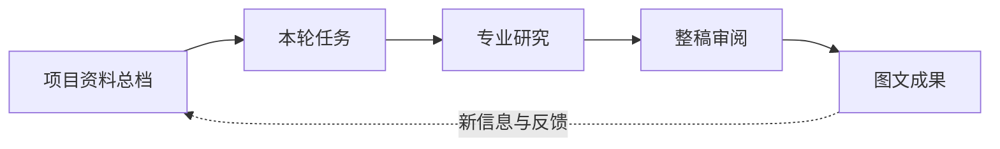
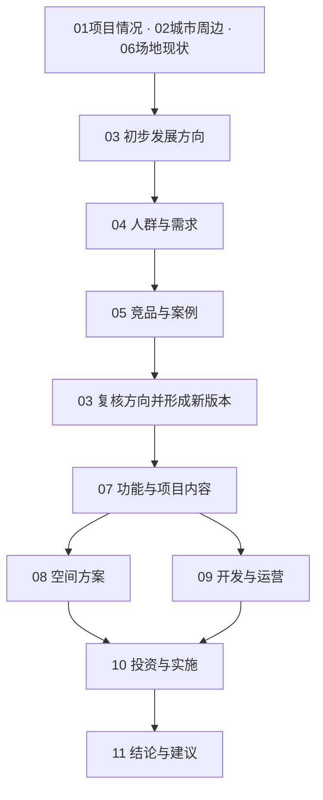

# Pre-design Web Skill 总流程

先按工作过程理解平台，再展开每个环节的Skill。以下为建议的整体组织方式。

文件、用户回答和检索证据持续进入总档。后续任务共享这些依据；资料、研究或用户决定改变时，更新对应版本并复核受影响环节。

| 环节 | 核心工作 | 产出 |
| --- | --- | --- |
| 资料总档 | 读取 → 提取 → 核对 → 持续归档 | 可追溯、持续更新的项目依据 |
| 本轮任务 | 理解目标 → 判断条件 → 选择任务 → 确认范围 | 本轮做什么、做到多深、按什么顺序 |
| 专业研究 | 基础研究 → 检验方向 → 形成方案 | 11章按需组合的研究成果 |
| 整稿审阅 | 组织论证 → 写正文 → 整理备注 → 审阅修改 | 经明确确认的章、节、条脚本 |
| 图文成果 | 选择图类 → 制作图文 → 统一排版 → 检查导出 | 可审阅、可修改、可交付的成果 |

用户问询、来源与质量核查、权限和版本管理贯穿全程。

## 专业研究内部的关系

这是完整项目的研究关系示意；按本轮任务选择工作，按已知条件决定深度。研究顺序与最终汇报目录分别管理。

## 需要细看时再展开

- [完整Skill分工与验收明细](DETAILS.md)
- [可筛选表格](matrix.csv)
- [结构化登记](matrix.json)

当前的“项目资料总档”需求，位于第一环节；其问询、版本和变更影响能力供后续全部环节共同使用。
